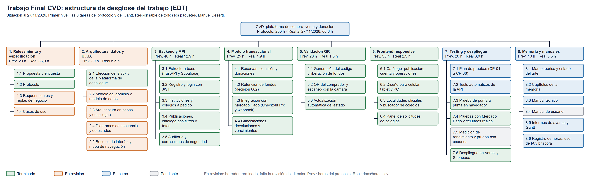

# Estructura de desglose del trabajo (EDT)

Situación al 27/11/2026. **Borrador para revisar con el director.**

El primer nivel son las 8 tareas del cronograma del protocolo, las mismas del Gantt y de [`docs/horas.csv`](../horas.csv). El segundo nivel son los paquetes de trabajo que efectivamente se hicieron o faltan hacer, armados a partir del registro de horas, del historial de git y de los capítulos de la memoria.

El diagrama se genera con `python docs/gestion/edt.py` (las horas reales se leen de `horas.csv`). Para el PNG: `node docs/informes/svg-a-png.mjs <ruta absoluta a frontend> "<edt.svg>|<edt.png>|1850|579|2"`.

## Diccionario de la EDT

| Código | Paquete de trabajo | Entregable o evidencia | Estado |
|---|---|---|---|
| **1** | **Relevamiento y especificación** (prev. 20 h) | | En revisión |
| 1.1 | Propuesta y encuesta | Propuesta revisada con el director; resultados de la encuesta | Terminado |
| 1.2 | Protocolo | Protocolo aprobado (aprobación preliminar del 20/10/2026) | Terminado |
| 1.3 | Requerimientos y reglas de negocio | [Cap. 01](../memoria/01-requerimientos.md): RF, RNF, RN-01 a RN-16 | En revisión |
| 1.4 | Casos de uso | [Cap. 06](../memoria/06-casos-de-uso.md) y `casos-de-uso.svg` | En revisión |
| **2** | **Arquitectura, datos y UI/UX** (prev. 30 h) | | En revisión |
| 2.1 | Elección del stack y de la plataforma de despliegue | Decisiones [001](../decisiones/001-stack-frontend.md) y [003](../decisiones/003-backend-en-vercel.md) | Terminado |
| 2.2 | Modelo del dominio y modelo de datos | [Cap. 02](../memoria/02-modelo-de-datos.md), `modelo-del-dominio.svg`, `modelo-de-datos.svg` | En revisión |
| 2.3 | Arquitectura en capas y despliegue | [Cap. 07](../memoria/07-diseno-del-sistema.md), `paquetes.svg`, `despliegue.svg` | En revisión |
| 2.4 | Diagramas de secuencia y de estados | `secuencia-pagar.svg`, `secuencia-cancelar.svg`, `estados-operacion.svg`, `estados-publicacion.svg` | En revisión |
| 2.5 | Bocetos de interfaz y mapa de navegación | [Cap. 05](../memoria/05-diseno-de-interfaz.md), `navegacion.svg` | En revisión |
| **3** | **Backend y API** (prev. 40 h) | | Terminado |
| 3.1 | Estructura base (FastAPI y Supabase) | `backend/` | Terminado |
| 3.2 | Registro y login con JWT | Contraseñas con bcrypt, bloqueo temporal del login | Terminado |
| 3.3 | Instituciones y colegios a pedido | Alta a pedido con publicación pendiente (RN-15) | Terminado |
| 3.4 | Publicaciones, catálogo con filtros y fotos | Catálogo paginado; fotos en Supabase Storage (RN-14) | Terminado |
| 3.5 | Auditoría y correcciones de seguridad | Auditoría del 03/11 (10 hallazgos); RLS en todas las tablas | Terminado |
| **4** | **Módulo transaccional** (prev. 25 h) | | Terminado |
| 4.1 | Reservas, comisión y donaciones | Comisión solo en ventas; tope de 3 donaciones (RN-12) | Terminado |
| 4.2 | Retención de fondos | Decisión [002](../decisiones/002-retencion-de-fondos.md) y [cap. 04](../memoria/04-regulatorio-y-produccion.md) | Terminado |
| 4.3 | Integración con Mercado Pago | Checkout Pro y webhook; [cap. 03](../memoria/03-arquitectura-y-pagos.md) | Terminado |
| 4.4 | Cancelaciones, devoluciones y vencimientos | Reembolsos automáticos; tarea diaria en Vercel (RN-08, RN-09) | Terminado |
| **5** | **Validación QR** (prev. 20 h) | | Terminado |
| 5.1 | Generación del código y liberación de fondos | Endpoint de liberación por QR (RN-04 a RN-07) | Terminado |
| 5.2 | QR del comprador y escaneo con la cámara | Pantallas de QR y de escaneo; probado con celulares reales el 09/11 | Terminado |
| 5.3 | Actualización automática del estado | La pantalla del QR se actualiza sola cada 5 s | Terminado |
| **6** | **Frontend responsive** (prev. 35 h) | | Terminado |
| 6.1 | Catálogo, publicación, cuenta y operaciones | `frontend/`, publicado en Vercel | Terminado |
| 6.2 | Diseño para celular, tablet y PC | Capturas en tres anchos (`frontend/e2e/capturas`) | Terminado |
| 6.3 | Localidades oficiales y buscador de colegios | Provincias y localidades de Georef (`localidades.json`) | Terminado |
| 6.4 | Panel de solicitudes de colegios | Pantalla de administración mínima (RF-13) | Terminado |
| **7** | **Testing y despliegue** (prev. 20 h) | | En curso |
| 7.1 | Plan de pruebas | [Cap. 08](../memoria/08-plan-de-pruebas.md): CP-01 a CP-36 | En curso |
| 7.2 | Tests automáticos de la API | `backend/tests/test_flujo.py` (15 tests); faltan CP-32 a CP-34 | En curso |
| 7.3 | Prueba de punta a punta en navegador | `frontend/e2e/flujo.mjs` (24 pasos) | Terminado |
| 7.4 | Pruebas con Mercado Pago y celulares reales | Sandbox y verificación con dinero real (03/11); pago y escaneo del QR entre dos celulares reales (CP-19, 09/11) | Terminado |
| 7.5 | Medición de rendimiento y prueba con usuarios | CP-35 y CP-36 | Pendiente |
| 7.6 | Despliegue en Vercel y Supabase | Backend y frontend publicados | Terminado |
| **8** | **Memoria y manuales** (prev. 10 h) | | En curso |
| 8.1 | Marco teórico y estado del arte | Fuentes seleccionadas (`docs/fuentes/`); falta la redacción | En curso |
| 8.2 | Capítulos de la memoria | `docs/memoria/` 00 a 08, en borrador | En curso |
| 8.3 | Manual técnico | [`docs/manuales/manual-tecnico.md`](../manuales/manual-tecnico.md) | En curso |
| 8.4 | Manual de usuario | | Pendiente |
| 8.5 | Informes de avance y Gantt | `docs/informes/` | En curso |
| 8.6 | Registro de horas, uso de IA y bitácora | [`horas.csv`](../horas.csv), [`uso-de-ia.md`](../uso-de-ia.md), [`bitacora.md`](bitacora.md) | En curso |

## Observaciones

- **Horas previstas y reales.** Se llevan 66,6 h de las 200 h del protocolo. La diferencia más grande está en las tareas 3 a 6 (21,6 h reales contra 120 h previstas), por el uso de IA desde noviembre. La tarea 1 es la única que superó lo previsto (33 h contra 20 h), por el relevamiento y la encuesta.
- **Fuera de la EDT.** Las funcionalidades opcionales del protocolo (alertas, administración completa, calificación) no están incluidas. Se suman como paquete nuevo si el director lo aprueba.
- **Estados.** "En revisión" quiere decir que el borrador está terminado y falta la revisión del director.
