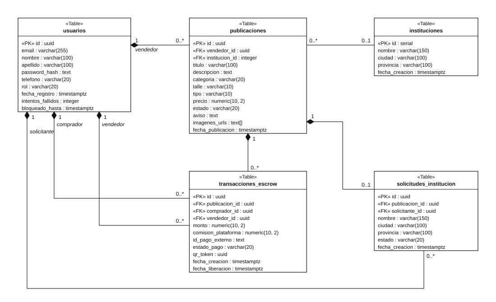
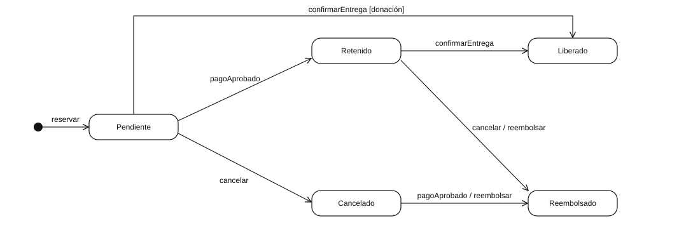

# 02 · Modelo de datos y estados

> Borrador. El esquema completo está en [`backend/database/schema.sql`](../../backend/database/schema.sql) y los cambios sobre la base existente en `backend/database/migraciones/`.

## Modelo de datos

El modelo de datos usa el perfil UML de modelado de datos (Larman, 2003, cap. 34, fig. 34.2):
- Cada tabla es una clase con el estereotipo «Table».
- Cada columna figura con su tipo de PostgreSQL. Las claves primarias se marcan con «PK» y las ajenas con «FK».
- Las relaciones son asociaciones con multiplicidad. Un 1 del lado de la tabla referenciada indica que la clave ajena es obligatoria (`NOT NULL`), y un 0..1, que puede quedar vacía.
- Como en el libro, las claves ajenas obligatorias llevan además un rombo relleno del lado de la tabla referenciada. Ese rombo de agregación indica que no puede existir una fila sin su fila relacionada; por ejemplo, una transacción sin su publicación. No significa que se borre en cascada: las filas no se borran (las publicaciones se dan de baja con un estado).



Las columnas y los tipos son los de `schema.sql`. Las restricciones que no se ven en el diagrama son:
- `email` y `qr_token` son únicos.
- Los valores permitidos de `rol`, `categoria`, `tipo` y de cada `estado` se controlan con `CHECK`.
- Está la restricción `precio_segun_tipo`, que se explica más abajo.

Que una publicación tenga como máximo una solicitud de colegio (0..1) lo garantiza el código y no la base. La solicitud solo se crea al publicar. Si se rechaza, el dueño elige otro colegio de la lista y no se crea otra.

Este modelo no es el modelo del dominio del capítulo 07: aquel muestra clases conceptuales del problema y este, cómo se guardan los datos.

Decisiones del modelo:

- **`vendedor_id` se repite en la transacción** aunque se podría obtener de la publicación. Así la transacción conserva quién vendió aunque la publicación cambie, y las consultas de historial no necesitan un JOIN.
- **`monto` y `comision_plataforma` se guardan en la transacción** (precio congelado): si el vendedor edita el precio después, la operación en curso no cambia.
- **`qr_token` es un UUID aleatorio** generado por la base. No se puede adivinar ni derivar de otros datos.
- **Las publicaciones no se borran:** se marcan con estado `baja` para no perder el historial de transacciones que las referencian.
- **Los usuarios guardan sus intentos de login fallidos** (`intentos_fallidos`, `bloqueado_hasta`): después de 5 seguidos, la cuenta se bloquea 15 minutos. El bloqueo vive en la base y no en la memoria del servidor porque el backend corre como funciones sin estado compartido.

### Ventas y donaciones: una entidad con discriminador de tipo

El protocolo define dos tipos de publicación, ventas y donaciones, que conviven en el mismo catálogo. Se evaluaron dos formas de modelarlas:

1. **Una interfaz común y dos subtipos** (idea inicial del autor): una tabla `publicaciones` con los datos compartidos y dos tablas hijas, `ventas` y `donaciones`, o la herencia de tablas de PostgreSQL.
2. **Una sola entidad con un discriminador de tipo:** la tabla `publicaciones` con un campo `tipo` (`venta` o `donacion`) y una restricción de integridad que ata el precio al tipo.

Se eligió la segunda. Ventas y donaciones comparten todos los atributos salvo el precio, así que los subtipos no tendrían columnas propias: solo agregarían JOINs en cada consulta del catálogo, que es la operación más frecuente. La regla que diferencia a los dos tipos queda garantizada por la base de datos:

```sql
CONSTRAINT precio_segun_tipo CHECK (
    (tipo = 'venta' AND precio > 0) OR (tipo = 'donacion' AND precio = 0)
)
```

La API valida lo mismo para devolver mensajes claros, pero la restricción en la base asegura la regla aunque un dato llegue por otro camino. Las donaciones se devuelven con `precio: 0` y el frontend muestra "Donación" en lugar de un importe.

## Estados de una transacción



El diagrama sigue la notación de Larman (2003, cap. 29):
- Cada transición se rotula con el evento que la dispara.
- Entre corchetes va la condición de guarda, que tiene que cumplirse para que la transición ocurra.
- Después de la barra va la acción que se ejecuta al pasar de estado.

Los estados llevan el mismo nombre que el valor de `estado_pago` en la base.

- **`cancelar`** lo dispara una de las partes (CU-12) o el Planificador de tareas cuando vence un plazo (CU-14), que ejecuta la misma cancelación. Si el pago estaba retenido, la acción `reembolsar` le pide la devolución a Mercado Pago.
- **`confirmarEntrega [donación]`**: una donación no tiene pago, así que se entrega directamente desde `Pendiente`.
- **`pagoAprobado / reembolsar`** desde `Cancelado` es el pago tardío: el comprador paga una reserva que ya venció, y el sistema le devuelve el dinero.

## Estados de una publicación

| Estado | Significado | Aparece en el catálogo |
|---|---|---|
| `disponible` | Se puede comprar o solicitar | Sí |
| `reservado` | Tiene una operación en curso | No |
| `vendido` | Se escaneó el QR (también para donaciones entregadas) | No |
| `baja` | El dueño la retiró | No |
| `pendiente_colegio` | Espera que se resuelva el alta de su colegio | No |
| `borrador` | El alta del colegio se rechazó y el dueño tiene que elegir otro | No |

Una operación cancelada, reembolsada o vencida devuelve la publicación a `disponible`.

## Concurrencia

Las operaciones que leen un estado y después lo cambian (comprar, escanear, cancelar, vencer, dar de baja) bloquean la fila con `SELECT ... FOR UPDATE` dentro de la misma transacción. Si dos compradores intentan reservar el mismo artículo a la vez, el segundo espera a que termine el primero y después encuentra el artículo `reservado`. Lo mismo evita que una cancelación y un escaneo simultáneos dejen la operación en un estado inconsistente.

## Referencias

Larman, C. (2003). *UML y patrones: Una introducción al análisis y diseño orientado a objetos y al proceso unificado* (2.ª ed.). Pearson Educación.
