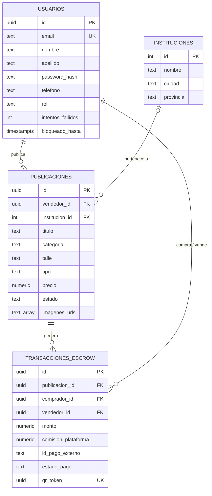
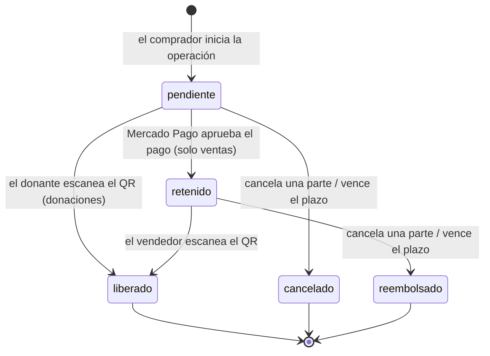

# 02 · Modelo de datos y estados

> Borrador. El esquema completo está en [`backend/database/schema.sql`](../../backend/database/schema.sql) y los cambios sobre la base existente en `backend/database/migraciones/`.

## Entidades



Decisiones del modelo:

- **`vendedor_id` se repite en la transacción** aunque se podría obtener de la publicación. Así la transacción conserva quién vendió aunque la publicación cambie, y las consultas de historial no necesitan un JOIN.
- **`monto` y `comision_plataforma` se guardan en la transacción** (precio congelado): si el vendedor edita el precio después, la operación en curso no cambia.
- **`qr_token` es un UUID aleatorio** generado por la base. No se puede adivinar ni derivar de otros datos.
- **Las publicaciones no se borran:** se marcan con estado `baja` para no perder el historial de transacciones que las referencian.
- **Los usuarios guardan sus intentos de login fallidos** (`intentos_fallidos`, `bloqueado_hasta`): después de 5 seguidos, la cuenta se bloquea 15 minutos. El bloqueo vive en la base y no en la memoria del servidor porque el backend corre como funciones sin estado compartido.

### Ventas y donaciones: una entidad con discriminador de tipo

El protocolo define dos tipos de publicación, ventas y donaciones, que conviven en el mismo catálogo. Se evaluaron dos formas de modelarlas:

1. **Una interfaz común y dos subtipos** (idea inicial del autor): una tabla `publicaciones` con los datos compartidos y dos tablas hijas, `ventas` y `donaciones`, o la herencia de tablas de PostgreSQL.
2. **Una sola entidad con un discriminador de tipo:** la tabla `publicaciones` con un campo `tipo` (`venta` o `donacion`) y una restricción de integridad que ata el precio al tipo.

Se eligió la segunda. Ventas y donaciones comparten todos los atributos salvo el precio, así que los subtipos no tendrían columnas propias: solo agregarían JOINs en cada consulta del catálogo, que es la operación más frecuente. La regla que diferencia a los dos tipos queda garantizada por la base de datos:

```sql
CONSTRAINT precio_segun_tipo CHECK (
    (tipo = 'venta' AND precio > 0) OR (tipo = 'donacion' AND precio = 0)
)
```

La API valida lo mismo para devolver mensajes claros, pero la restricción en la base asegura la regla aunque un dato llegue por otro camino. Las donaciones se devuelven con `precio: 0` y el frontend muestra "Donación" en lugar de un importe.

## Estados de una transacción



## Estados de una publicación

| Estado | Significado | Aparece en el catálogo |
|---|---|---|
| `disponible` | Se puede comprar o solicitar | Sí |
| `reservado` | Tiene una operación en curso | No |
| `vendido` | Se escaneó el QR (también para donaciones entregadas) | No |
| `baja` | El dueño la retiró | No |

Una operación cancelada, reembolsada o vencida devuelve la publicación a `disponible`.

## Concurrencia

Las operaciones que leen un estado y después lo cambian (comprar, escanear, cancelar, vencer, dar de baja) bloquean la fila con `SELECT ... FOR UPDATE` dentro de la misma transacción. Si dos compradores intentan reservar el mismo artículo a la vez, el segundo espera a que termine el primero y después encuentra el artículo `reservado`. Lo mismo evita que una cancelación y un escaneo simultáneos dejen la operación en un estado inconsistente.
