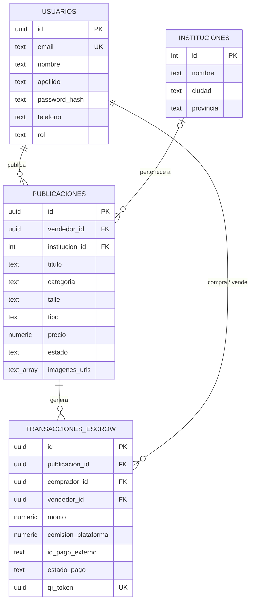
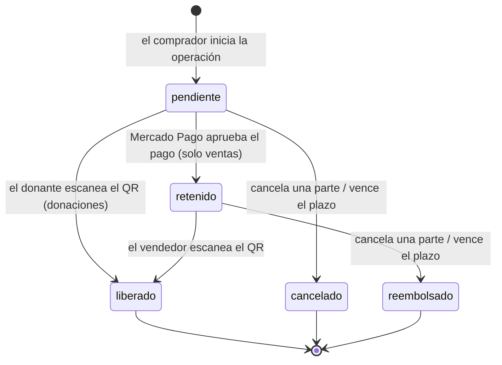

# 02 · Modelo de datos y estados

> Borrador. El esquema completo está en [`backend/database/schema.sql`](../../backend/database/schema.sql) y los cambios sobre la base existente en `backend/database/migraciones/`.

## Entidades

Decisiones del modelo:

- **`vendedor_id` se repite en la transacción** aunque se podría obtener de la publicación. Así la transacción conserva quién vendió aunque la publicación cambie, y las consultas de historial no necesitan un JOIN.
- **`monto` y `comision_plataforma` se guardan en la transacción** (precio congelado): si el vendedor edita el precio después, la operación en curso no cambia.
- **`qr_token` es un UUID aleatorio** generado por la base. No se puede adivinar ni derivar de otros datos.
- **Las publicaciones no se borran:** se marcan con estado `baja` para no perder el historial de transacciones que las referencian.

## Estados de una transacción

## Estados de una publicación

| Estado | Significado | Aparece en el catálogo |
|---|---|---|
| `disponible` | Se puede comprar o solicitar | Sí |
| `reservado` | Tiene una operación en curso | No |
| `vendido` | Se escaneó el QR (también para donaciones entregadas) | No |
| `baja` | El dueño la retiró | No |

Una operación cancelada, reembolsada o vencida devuelve la publicación a `disponible`.

## Concurrencia

Las operaciones que leen un estado y después lo cambian (comprar, escanear, cancelar, vencer, dar de baja) bloquean la fila con `SELECT ... FOR UPDATE` dentro de la misma transacción. Si dos compradores intentan reservar el mismo artículo a la vez, el segundo espera a que termine el primero y después encuentra el artículo `reservado`. Lo mismo evita que una cancelación y un escaneo simultáneos dejen la operación en un estado inconsistente.
