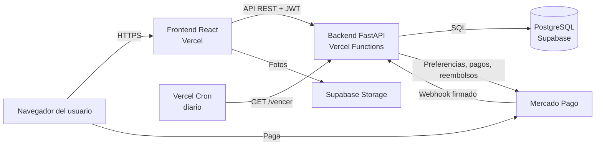
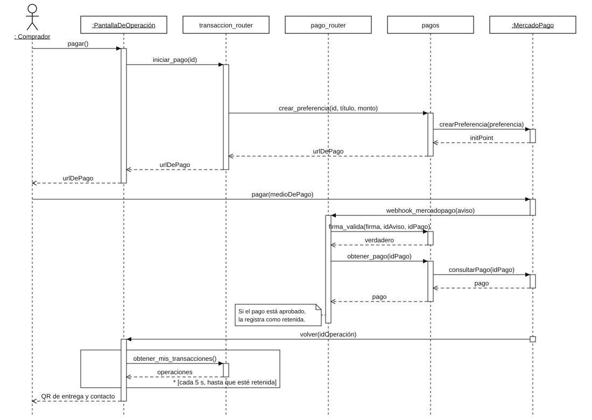
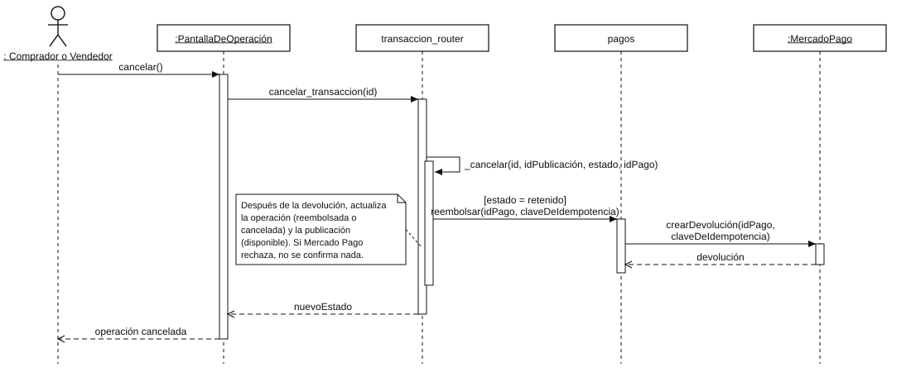

# 03 · Arquitectura y flujo de pago

> Borrador. Decisiones relacionadas: [001](../decisiones/001-stack-frontend.md), [002](../decisiones/002-retencion-de-fondos.md), [003](../decisiones/003-backend-en-vercel.md).

## Componentes

| Componente | Responsabilidad |
|---|---|
| Frontend | Interfaz responsive, generación y escaneo del QR |
| Backend | Reglas de negocio, autenticación, máquina de estados, integración con Mercado Pago |
| Base de datos | Persistencia; RLS activo para cerrar el acceso directo por la API pública de Supabase |
| Mercado Pago | Cobro al comprador y devoluciones (sandbox en el prototipo) |
| Vercel Cron | Vencimiento diario de operaciones; mantiene activa la base |

## Diagramas de secuencia de la integración con Mercado Pago

Son diagramas de interacción de diseño, con la notación de Larman (2003, cap. 15). Los participantes son las piezas del software que colaboran en cada caso de uso:
- `:PantallaDeOperación` es la pantalla del frontend (`Transaccion.tsx`). Es una instancia, por eso va subrayada.
- `transaccion_router` y `pago_router` reciben los pedidos.
- `pagos` es el módulo que habla con Mercado Pago.

Estos tres son módulos de Python sin clases, que se usan llamando a sus funciones. Larman (2003, fig. 15.27) dibuja los mensajes a una clase, y no a una instancia, con el nombre sin subrayar.

Los mensajes son las funciones reales del código, con sus parámetros. Las llamadas a Mercado Pago, que es un sistema externo, se nombran por su intención. Los accesos a la base de datos no son mensajes entre objetos, así que figuran como notas.

Además:
- Las cajas de activación muestran quién tiene el control en cada momento.
- Los retornos van en línea punteada.
- Una condición entre corchetes indica que el mensaje se envía solo si se cumple.
- El asterisco marca una iteración.

Hay un diagrama por caso de uso. Se muestran los dos que pasan por Mercado Pago, que son las integraciones críticas del sistema. La reserva y la confirmación de la entrega no involucran sistemas externos, y sus pasos están en el capítulo 06.

### CU-08 · Pagar la reserva

Antes de crear la preferencia, `iniciar_pago` lee la operación y verifica que sea una venta pendiente del comprador que pide pagar. Cuando llega el aviso, `pago_router` no se fía de su contenido: verifica la firma y le consulta el pago a Mercado Pago (RNF-07).

El pago se confirma por dos caminos que no dependen entre sí:
- Mercado Pago le avisa al backend que recibió el pago (`webhook_mercadopago`).
- Mercado Pago lleva al comprador de vuelta a la pantalla de la operación (`volver`).

Como el aviso puede llegar después de que el comprador vuelve, la pantalla consulta las operaciones cada 5 segundos hasta ver la suya retenida.

### CU-12 · Cancelar una operación

Antes de llamar a `_cancelar`, `cancelar_transaccion` lee la operación con bloqueo de fila, para que una cancelación y un escaneo simultáneos no se pisen. También verifica que el usuario sea parte de la operación y que esta siga pendiente o retenida. La devolución se pide antes de modificar la base. Los dos cambios en la base, el de la operación y el de la publicación, se confirman juntos al final.

## Decisiones de diseño del pago

- **El webhook no se cree a sí mismo.** Primero se verifica la firma HMAC-SHA256 (`x-signature`) con la clave secreta de la aplicación; después se consulta el pago a la API de Mercado Pago. El cuerpo del aviso nunca se usa como fuente de verdad.
- **Idempotencia.** Mercado Pago reintenta los avisos que no reciben un 200. Solo la transición `pendiente → retenido` modifica la base, así que recibir el mismo aviso dos veces no tiene efecto.
- **Pago tardío.** Si llega un pago aprobado para una operación ya cancelada (por ejemplo, la reserva venció mientras el comprador pagaba), se devuelve automáticamente.
- **Devoluciones seguras de reintentar.** Cada devolución se envía con una clave de idempotencia (`reembolso-{transacción}`); si se reintenta, Mercado Pago no devuelve dos veces.
- **Primero Mercado Pago, después la base.** Al cancelar una operación pagada, la devolución se pide antes de cambiar el estado. Si Mercado Pago la rechaza, la operación queda como estaba.
- **Preferencias con vencimiento.** La preferencia de pago vence a las 24 horas, el mismo plazo con el que se libera una reserva sin pagar.
- **Liberación al vendedor.** En el prototipo, liberar los fondos es un cambio de estado: el dinero ya está en la cuenta de la plataforma y la transferencia al vendedor se considera fuera del alcance (ver decisión 002).

## Plazos

| Plazo | Valor | Qué pasa al vencer |
|---|---|---|
| Pago de una reserva | 24 horas | La venta pasa a `cancelado` y el artículo vuelve al catálogo |
| Encuentro (venta) | 7 días | Se cancela y el pago se devuelve (`reembolsado`) |
| Encuentro (donación) | 4 días | Se cancela y el artículo vuelve al catálogo |

## Referencias

Larman, C. (2003). *UML y patrones: Una introducción al análisis y diseño orientado a objetos y al proceso unificado* (2.ª ed.). Pearson Educación.
