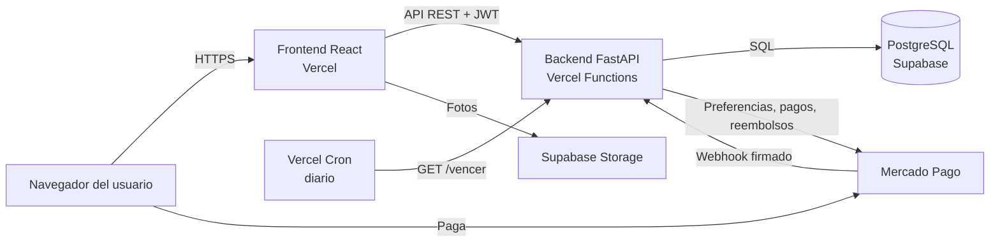
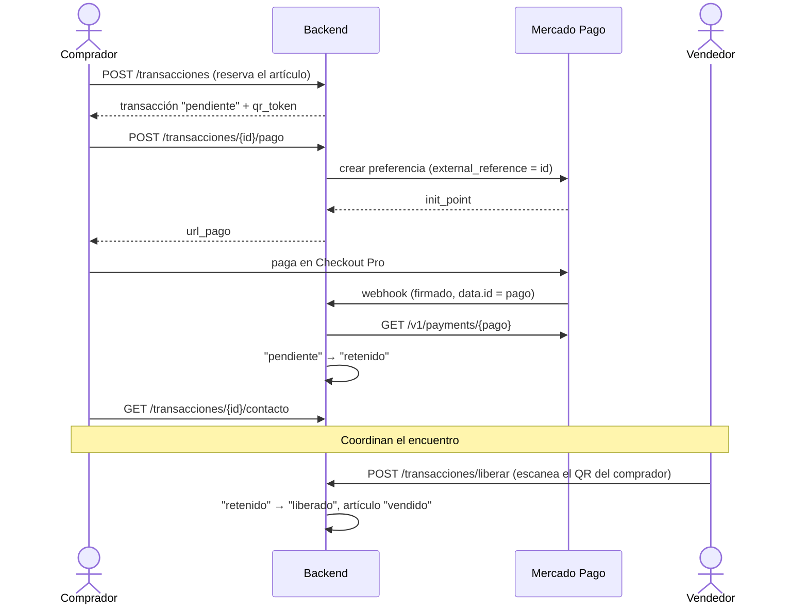

# 03 · Arquitectura y flujo de pago

> Borrador. Decisiones relacionadas: [001](../decisiones/001-stack-frontend.md), [002](../decisiones/002-retencion-de-fondos.md), [003](../decisiones/003-backend-en-vercel.md).

## Componentes

| Componente | Responsabilidad |
|---|---|
| Frontend | Interfaz responsive, generación y escaneo del QR |
| Backend | Reglas de negocio, autenticación, máquina de estados, integración con Mercado Pago |
| Base de datos | Persistencia; RLS activo para cerrar el acceso directo por la API pública de Supabase |
| Mercado Pago | Cobro al comprador y devoluciones (sandbox en el prototipo) |
| Vercel Cron | Vencimiento diario de operaciones; mantiene activa la base |

## Flujo de una venta

## Decisiones de diseño del pago

- **El webhook no se cree a sí mismo.** Primero se verifica la firma HMAC-SHA256 (`x-signature`) con la clave secreta de la aplicación; después se consulta el pago a la API de Mercado Pago. El cuerpo del aviso nunca se usa como fuente de verdad.
- **Idempotencia.** Mercado Pago reintenta los avisos que no reciben un 200. Solo la transición `pendiente → retenido` modifica la base, así que recibir el mismo aviso dos veces no tiene efecto.
- **Pago tardío.** Si llega un pago aprobado para una operación ya cancelada (por ejemplo, la reserva venció mientras el comprador pagaba), se devuelve automáticamente.
- **Devoluciones seguras de reintentar.** Cada devolución se envía con una clave de idempotencia (`reembolso-{transacción}`); si se reintenta, Mercado Pago no devuelve dos veces.
- **Primero Mercado Pago, después la base.** Al cancelar una operación pagada, la devolución se pide antes de cambiar el estado. Si Mercado Pago la rechaza, la operación queda como estaba.
- **Preferencias con vencimiento.** La preferencia de pago vence a las 24 horas, el mismo plazo con el que se libera una reserva sin pagar.
- **Liberación al vendedor.** En el prototipo, liberar los fondos es un cambio de estado: el dinero ya está en la cuenta de la plataforma y la transferencia al vendedor se considera fuera del alcance (ver decisión 002).

## Plazos

| Plazo | Valor | Qué pasa al vencer |
|---|---|---|
| Pago de una reserva | 24 horas | La venta pasa a `cancelado` y el artículo vuelve al catálogo |
| Encuentro | 7 días | Se cancela; si había pago, se devuelve (`reembolsado`) |
