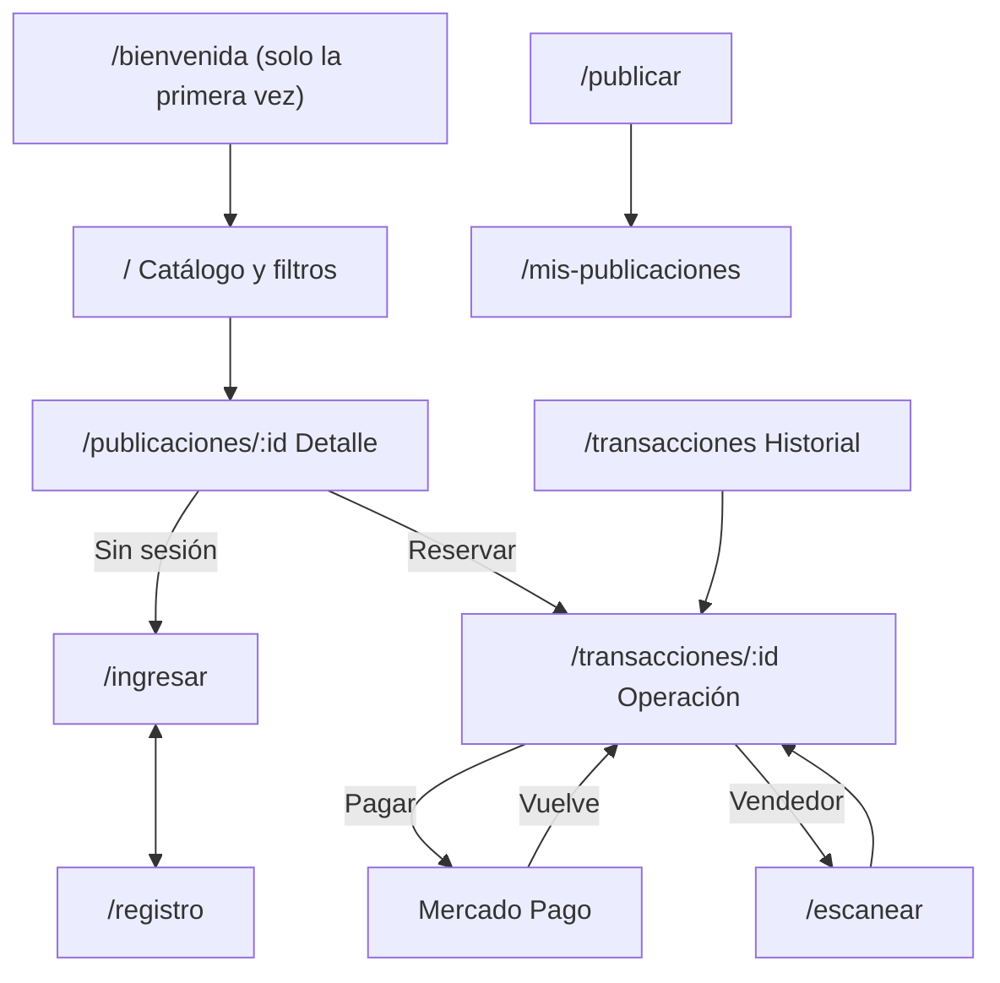

# 05 · Diseño de la interfaz

> Borrador. Decisión relacionada: [001](../decisiones/001-stack-frontend.md). Faltan las capturas de los bocetos y de las pantallas terminadas.

La interfaz se diseña primero para celular, porque el escaneo ocurre en el encuentro presencial. La navegación principal es una barra inferior con cuatro íconos: Catálogo, Publicar, Mis artículos y Operaciones; cada nombre es el título de su sección.

La primera visita muestra una bienvenida sin registro: el lema, cómo funciona en tres pasos y la elección de la ubicación, que queda guardada en el navegador para filtrar el catálogo. Las visitas siguientes y los enlaces directos a un artículo no pasan por ella. El ingreso se pide recién al reservar, publicar o entrar a una sección privada, y al terminar se vuelve a lo que se estaba haciendo.

El estilo surgió de comparar cuatro direcciones visuales: fondo de hoja cuadriculada, títulos manuscritos (Caveat), azul marino y naranja como colores principales, y tarjetas con bordes suaves.

## Mapa de navegación

| Ruta | Función | Requerimientos | Sesión |
|---|---|---|---|
| `/bienvenida` | Presentación y ubicación, solo la primera vez | – | No |
| `/` | Catálogo con filtros en cascada y scroll infinito | RF-03 | No |
| `/publicaciones/:id` | Detalle y reserva | RF-05 | Solo para reservar |
| `/ingresar`, `/registro` | Cuenta | RF-01 | No |
| `/publicar` | Alta con fotos | RF-02 | Sí |
| `/mis-publicaciones` | Ver y dar de baja | RF-04 | Sí |
| `/transacciones` | Historial | RF-11 | Sí |
| `/transacciones/:id` | Pagar, QR, contacto y cancelar | RF-06 a RF-09 | Sí |
| `/escanear` | Cámara del vendedor | RF-07 | Sí |
| `/admin/solicitudes` | Resolver el alta de colegios | RF-13 | Administrador |

## Qué muestra una operación según su estado

| Estado | Comprador o receptor | Vendedor o donante |
|---|---|---|
| Venta `pendiente` | Pagar, cancelar | Espera del pago, cancelar |
| Venta `retenido` | QR, contacto, cancelar con devolución | Escanear, contacto, cancelar con devolución |
| Donación `pendiente` | QR, contacto, cancelar | Escanear, contacto, cancelar |
| `liberado` | Operación concretada, contacto | Operación concretada, contacto |
| `cancelado`, `reembolsado` | Solo informativo | Solo informativo |

El QR se muestra únicamente en los estados en los que se puede escanear (RN-06). La tabla sigue las reglas RN-04 a RN-10.
