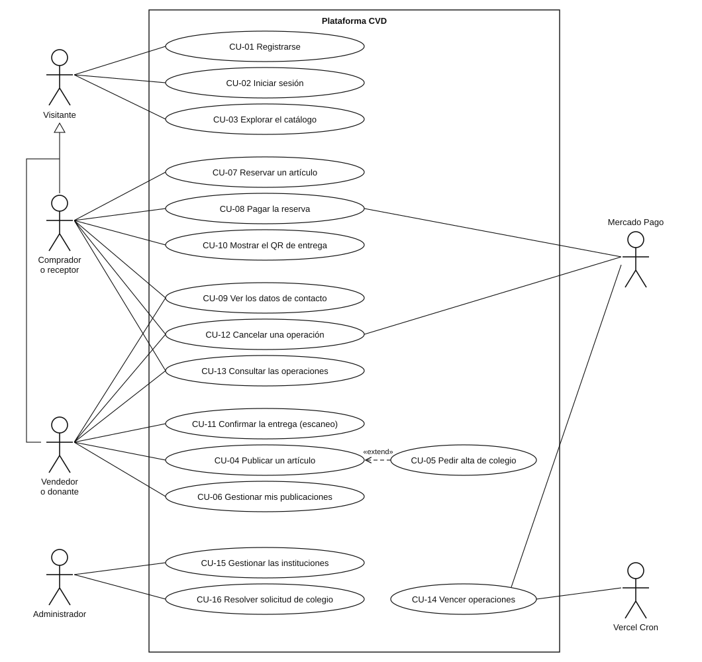

# 06 · Casos de uso

> Borrador. Cada caso se relaciona con los requerimientos del [capítulo 01](01-requerimientos.md).

Los casos de uso siguen el formato completo de Larman (2003, cap. 6). Se escriben en estilo esencial, de caja negra: dicen qué hace el sistema y no cómo lo hace. Lo técnico va en la sección *Tecnología y variaciones*. El escenario principal no tiene condicionales. Cada bifurcación va en *Extensiones*, con el número del paso donde ocurre y una letra (por ejemplo, 4a). Entre casos de uso solo se usa la relación «include» (Larman, 2003, cap. 25).

El nivel de cada caso distingue los **objetivos de usuario**, que son tareas completas con valor para quien las hace, de las **subfunciones**, que son partes de otros casos. El diagrama muestra solo los primeros.

## Diagrama

## Lista de casos de uso

| Código | Caso de uso | Nivel | Actor principal | Actores de apoyo | Requerimientos |
|---|---|---|---|---|---|
| CU-01 | Registrarse | Objetivo de usuario | Visitante | | RF-01 |
| CU-02 | Iniciar sesión | Subfunción | Visitante | | RF-01 |
| CU-03 | Explorar el catálogo | Objetivo de usuario | Visitante | | RF-03 |
| CU-04 | Publicar un artículo | Objetivo de usuario | Vendedor | | RF-02 |
| CU-05 | Pedir el alta de un colegio | Subfunción (incluido por CU-04) | Vendedor | | RF-13 |
| CU-06 | Gestionar las publicaciones propias | Objetivo de usuario | Vendedor | | RF-04, RF-13 |
| CU-07 | Reservar un artículo | Objetivo de usuario | Comprador | | RF-05 |
| CU-08 | Pagar la reserva | Objetivo de usuario | Comprador | Mercado Pago | RF-06 |
| CU-09 | Ver los datos de contacto | Subfunción | Comprador o Vendedor | | RF-08 |
| CU-10 | Mostrar el código QR de entrega | Subfunción (parte de CU-11) | Comprador | | RF-07 |
| CU-11 | Confirmar la entrega | Objetivo de usuario | Vendedor | | RF-07 |
| CU-12 | Cancelar una operación | Objetivo de usuario (incluido por CU-14) | Comprador o Vendedor | Mercado Pago | RF-09 |
| CU-13 | Consultar las operaciones | Objetivo de usuario | Comprador o Vendedor | | RF-11 |
| CU-14 | Vencer las operaciones | Objetivo de usuario | Planificador de tareas | Mercado Pago | RF-10 |
| CU-15 | Gestionar las instituciones | Objetivo de usuario | Administrador | | RF-12 |
| CU-16 | Resolver una solicitud de colegio | Objetivo de usuario | Administrador | | RF-13 |

## Especificación de los casos principales

### CU-03 · Explorar el catálogo

**Actor principal:** Visitante.
**Nivel:** objetivo de usuario.

**Personal involucrado e intereses**
- Visitante: quiere encontrar rápido uniformes de su colegio y de su talle.
- Vendedor: quiere que su publicación la vean las familias de su colegio.

**Precondiciones:** ninguna.
**Garantías de éxito (postcondiciones):** no cambia ningún dato. Solo se muestran artículos disponibles.

**Escenario principal de éxito**
1. El Visitante indica su provincia, localidad y colegio.
2. El Sistema muestra los artículos disponibles de esa ubicación, de a 20.
3. El Visitante filtra por categoría, tipo y talle, o cambia la ubicación.
4. El Sistema actualiza la lista.

   *El Visitante repite los pasos 3 y 4 hasta encontrar un artículo.*
5. El Visitante abre el detalle de un artículo.
6. El Sistema muestra las fotos, el precio o si es una donación, el talle y el colegio.

**Extensiones**
- 1a. El Visitante ya eligió su ubicación en una visita anterior: el Sistema la recuerda y sigue en el paso 2.
- 2-4a. Ningún artículo coincide: el Sistema informa que no hay artículos con esos filtros.
- 2-4b. El Visitante llega al final de la lista y hay más artículos: el Sistema agrega los 20 siguientes.

**Requisitos especiales:** el catálogo es público (RN-16). Responde en menos de 3 segundos (RNF-10) y se usa sin desplazamiento horizontal en el celular (RNF-08).

**Tecnología y variaciones**
- 1. Las provincias y localidades son las oficiales de Georef. La ubicación elegida se guarda en el navegador.

### CU-04 · Publicar un artículo

**Actor principal:** Vendedor o donante.
**Nivel:** objetivo de usuario.

**Personal involucrado e intereses**
- Vendedor: quiere publicar rápido desde el celular y que lo vean las familias de su colegio.
- Comprador: quiere fotos reales y datos correctos, sobre todo el talle y el colegio.
- Plataforma: quiere publicaciones válidas, asociadas a un colegio que exista.

**Precondiciones:** ninguna.
**Garantías de éxito (postcondiciones):** existe una publicación del Vendedor, con sus fotos y un colegio. Aparece en el catálogo, salvo que espere el alta del colegio.

**Escenario principal de éxito**
1. El Vendedor indica título, categoría, talle y tipo de publicación (venta o donación).
2. El Vendedor indica el precio.
3. El Vendedor agrega las fotos del artículo.
4. El Vendedor elige provincia, localidad y colegio.
5. El Sistema valida los datos y registra la publicación como disponible.
6. El Sistema muestra la publicación en el catálogo.

**Extensiones**
- 1a. El Vendedor no se identificó:
  1. El Sistema le pide que se identifique (CU-02).
  2. El Vendedor se identifica y sigue en el paso 1.
- 2a. Es una donación: el Vendedor no indica precio, porque la donación no tiene precio ni comisión (RN-01). Sigue en el paso 3.
- 3a. El Vendedor agrega más de 5 fotos, o una de un formato o tamaño no permitido: el Sistema la rechaza e informa el motivo (RN-14).
- 4a. El colegio no está en la lista: <u>incluye *CU-05 Pedir el alta de un colegio*</u>.
- 5a. El precio no corresponde al tipo de publicación: el Sistema rechaza la publicación e informa el motivo (RN-01).
- 5b. Alguna foto no fue subida por el Vendedor: el Sistema rechaza la publicación (RN-14).

**Requisitos especiales:** se usa desde el celular, sin desplazamiento horizontal (RNF-08).

**Tecnología y variaciones**
- 3. Las fotos se reducen en el navegador y se suben a Supabase Storage con una URL firmada.
- 4. Las provincias y localidades son las oficiales de Georef.

### CU-05 · Pedir el alta de un colegio

**Actor principal:** Vendedor.
**Nivel:** subfunción. Lo incluye CU-04 en su extensión 4a.

**Personal involucrado e intereses**
- Vendedor: quiere publicar aunque su colegio no esté en la lista.
- Administrador: quiere una lista de colegios sin duplicados ni nombres inventados.

**Precondiciones:** el Vendedor está publicando (CU-04) y su colegio no aparece en la lista.
**Garantías de éxito (postcondiciones):** existe una solicitud pendiente para el Administrador. La publicación no aparece en el catálogo hasta que se resuelva (RN-15).

**Escenario principal de éxito**
1. El Vendedor escribe el nombre del colegio.
2. El Sistema registra la publicación como pendiente de colegio y una solicitud de alta para el Administrador.
3. El Sistema le informa al Vendedor que la publicación se verá cuando se acepte el colegio.

### CU-07 · Reservar un artículo

**Actor principal:** Comprador o receptor.
**Nivel:** objetivo de usuario.

**Personal involucrado e intereses**
- Comprador: quiere asegurarse el artículo antes de que lo tome otra persona.
- Vendedor: quiere que la reserva sea de alguien que va a concretar.
- Plataforma: quiere cobrar su comisión en las ventas y que un artículo nunca tenga dos operaciones a la vez.

**Precondiciones:** el Comprador está viendo el detalle de un artículo (CU-03).
**Garantías de éxito (postcondiciones):** existe una operación pendiente, con el precio congelado y la comisión calculada. El artículo deja de verse en el catálogo.

**Escenario principal de éxito**
1. El Comprador pide reservar el artículo.
2. El Sistema verifica que el artículo siga disponible y que no sea del Comprador.
3. El Sistema registra la operación como pendiente, con el precio del momento y una comisión del 5 %.
4. El Sistema marca el artículo como reservado.
5. El Sistema le presenta al Comprador el pago de la reserva (CU-08).

**Extensiones**
- 1a. El Comprador no se identificó:
  1. El Sistema le pide que se identifique (CU-02).
  2. El Comprador se identifica y sigue en el paso 1.
- 2a. Otra persona reservó el artículo antes: el Sistema lo informa y no registra la operación (RN-03).
- 2b. El artículo es del Comprador: el Sistema rechaza la reserva (RN-02).
- 2c. Es una donación y el receptor ya tiene 3 donaciones pendientes: el Sistema rechaza la reserva (RN-12).
- 3a. Es una donación: el Sistema registra la operación sin precio ni comisión (RN-01).
- 5a. Es una donación: el Sistema le muestra al receptor el QR de entrega (CU-10) y los datos de contacto (CU-09). El caso termina.

**Requisitos especiales:** aunque dos personas reserven el mismo artículo al mismo tiempo, solo una lo consigue (RN-03, RNF-06).

**Tecnología y variaciones**
- 2-4. La verificación y el registro se hacen en una sola transacción de base de datos, con bloqueo de fila.

### CU-08 · Pagar la reserva

**Actor principal:** Comprador.
**Actores de apoyo:** Mercado Pago.
**Nivel:** objetivo de usuario.

**Personal involucrado e intereses**
- Comprador: quiere que el vendedor no cobre hasta entregarle el artículo.
- Vendedor: quiere tener el cobro asegurado antes del encuentro.
- Plataforma: quiere cobrar su comisión y que nadie pueda simular un pago.

**Precondiciones:** el Comprador tiene una venta pendiente (CU-07).
**Garantías de éxito (postcondiciones):** el pago queda retenido hasta la entrega y el Vendedor todavía no dispone del dinero. El Comprador ve el QR de entrega y los datos de contacto.

**Escenario principal de éxito**
1. El Comprador elige pagar.
2. El Sistema le solicita el cobro a Mercado Pago, con vencimiento a 24 horas, y lleva al Comprador a pagar.
3. El Comprador paga en Mercado Pago y vuelve a la plataforma.
4. El Sistema le informa que está confirmando el pago.
5. Mercado Pago le avisa al Sistema que recibió el pago.
6. El Sistema verifica el aviso y confirma el pago con Mercado Pago.
7. El Sistema registra el pago como retenido.
8. El Sistema le muestra al Comprador el QR de entrega (CU-10) y los datos de contacto (CU-09).

**Extensiones**
- 3a. El Comprador abandona el pago: puede volver a intentarlo mientras la reserva siga vigente.
- 6a. El aviso no es auténtico: el Sistema lo rechaza y no cambia nada (RNF-07).
- 6b. El mismo aviso llega más de una vez: el Sistema lo procesa una sola vez (RNF-07).
- 7a. La operación ya estaba cancelada cuando llegó el pago:
  1. El Sistema le pide la devolución a Mercado Pago.
  2. El Sistema registra la operación como reembolsada.

**Requisitos especiales:** el pago solo se acepta con un aviso auténtico y confirmado contra Mercado Pago (RNF-07).

**Tecnología y variaciones**
- 2. Checkout Pro de Mercado Pago, en modo sandbox en el prototipo.
- 5. El aviso es un webhook firmado con HMAC-SHA256.
- 8. La vista del Comprador se actualiza sola cuando se confirma el pago.

### CU-11 · Confirmar la entrega

**Actor principal:** Vendedor.
**Otros participantes:** Comprador, que muestra el QR (CU-10).
**Nivel:** objetivo de usuario.

**Personal involucrado e intereses**
- Comprador: quiere que el dinero se libere solo si recibió el artículo.
- Vendedor: quiere cobrar en el momento de entregar.
- Plataforma: quiere una prueba de entrega que no se pueda falsificar.

**Precondiciones:** el Vendedor se identificó. El Vendedor y el Comprador están juntos, con el artículo.
**Garantías de éxito (postcondiciones):** la entrega queda confirmada y la operación ya no se puede cancelar (RN-07).

**Escenario principal de éxito**
1. El Comprador muestra el QR de entrega (CU-10).
2. El Vendedor lee el QR desde la operación.
3. El Sistema identifica la operación y verifica que quien lee sea su vendedor y que el pago esté retenido.
4. El Sistema registra la operación como liberada y el artículo como vendido.
5. El Sistema les informa a ambos que la entrega quedó confirmada.

**Extensiones**
- 3a. El código no corresponde a ninguna operación: el Sistema informa que es inválido.
- 3b. Quien lee no es el vendedor de la operación: el Sistema rechaza la lectura (RN-05).
- 3c. Es una donación: el Sistema no exige pago retenido, alcanza con que la operación esté pendiente (RN-06). Sigue en el paso 4.
- 3d. El pago no está retenido o la operación ya terminó: el Sistema rechaza la lectura (RN-06).

**Requisitos especiales:** el QR se lee con el celular, sin instalar una aplicación (RNF-09). Solo el comprador ve el QR (RN-04).

**Tecnología y variaciones**
- 2. El QR se lee con la cámara del celular desde el navegador.
- 5. La vista del Comprador consulta el estado cada 5 segundos.

### CU-12 · Cancelar una operación

**Actor principal:** Comprador o Vendedor.
**Actores de apoyo:** Mercado Pago.
**Nivel:** objetivo de usuario. También lo incluye CU-14.

**Personal involucrado e intereses**
- Comprador: quiere recuperar su dinero si la entrega no se hace.
- Vendedor: quiere volver a ofrecer el artículo.
- Plataforma: quiere que el dinero y el estado del artículo nunca queden inconsistentes.

**Precondiciones:** el actor se identificó y es parte de la operación.
**Garantías de éxito (postcondiciones):** la operación queda cerrada, el dinero vuelve al Comprador si había pago y el artículo vuelve al catálogo. El QR deja de servir.

**Escenario principal de éxito**
1. El actor pide cancelar la operación y confirma.
2. El Sistema verifica que la entrega no se haya confirmado.
3. El Sistema registra la operación como cancelada.
4. El Sistema vuelve a ofrecer el artículo en el catálogo.

**Extensiones**
- 2a. La entrega ya se confirmó o la operación ya terminó: el Sistema rechaza la cancelación (RN-07).
- 3a. El pago estaba retenido:
  1. El Sistema le pide la devolución a Mercado Pago.
     - 1a. Mercado Pago rechaza la devolución: la operación queda como estaba y el Sistema informa el error.
  2. El Sistema registra la operación como reembolsada. Sigue en el paso 4.

**Requisitos especiales:** la cancelación y la devolución se hacen como una sola unidad (RNF-06).

**Tecnología y variaciones**
- 3a. Primero se pide la devolución a Mercado Pago y recién después se modifica la base de datos.

### CU-14 · Vencer las operaciones

**Actor principal:** Planificador de tareas.
**Actores de apoyo:** Mercado Pago, a través de CU-12.
**Nivel:** objetivo de usuario.

**Personal involucrado e intereses**
- Comprador: quiere recuperar su dinero si la entrega nunca ocurre.
- Vendedor: quiere que una reserva abandonada no le bloquee el artículo.

**Precondiciones:** ninguna.
**Garantías de éxito (postcondiciones):** las operaciones vencidas quedan cerradas y sus artículos vuelven al catálogo (RN-09).

**Escenario principal de éxito**
1. El Planificador le pide al Sistema que venza las operaciones.
2. El Sistema busca las ventas sin pagar con más de 24 horas y las operaciones sin entrega con más de 7 días (4 en las donaciones).
3. Para cada una, <u>incluye *CU-12 Cancelar una operación*</u>.
4. El Sistema informa cuántas venció y cuántas fallaron.

**Extensiones**
- 1a. El pedido no trae la clave del Planificador: el Sistema lo rechaza.
- 3a. Mercado Pago rechaza una devolución: esa operación queda como estaba y se vuelve a intentar en la próxima ejecución.

**Tecnología y variaciones**
- 1. Vercel Cron llama una vez por día a `GET /vencer` con una clave secreta.

### CU-16 · Resolver una solicitud de colegio

**Actor principal:** Administrador.
**Nivel:** objetivo de usuario.

**Personal involucrado e intereses**
- Vendedor: quiere que su publicación salga pronto y con el colegio correcto.
- Administrador: quiere evitar colegios duplicados o inexistentes.

**Precondiciones:** el Administrador se identificó. Hay una solicitud pendiente.
**Garantías de éxito (postcondiciones):** la solicitud queda resuelta y no se puede resolver dos veces. La publicación queda publicada o en borrador.

**Escenario principal de éxito**
1. El Administrador revisa una solicitud pendiente.
2. El Administrador acepta el colegio.
3. El Sistema registra el colegio y lo asigna a la publicación.
4. El Sistema publica el artículo en el catálogo.

**Extensiones**
- 2a. El colegio ya existía con otro nombre:
  1. El Administrador indica cuál es.
  2. El Sistema asigna ese colegio a la publicación y le avisa al dueño con qué colegio quedó. Sigue en el paso 4.
- 2b. El colegio no existe:
  1. El Administrador rechaza la solicitud.
  2. El Sistema pasa la publicación a borrador y le avisa al dueño, que puede elegir otro colegio (CU-06). El caso termina.
- 4a. El dueño dio de baja la publicación mientras esperaba: el Sistema resuelve la solicitud, pero no publica el artículo.

**Requisitos especiales:** solo un usuario con rol de administrador puede resolver solicitudes (RNF-04). Ver RN-15.

## Casos de uso secundarios (formato breve)

| Código | Resumen |
|---|---|
| CU-01 | El Visitante carga sus datos. El Sistema valida el correo y la contraseña (8 caracteres o más), crea la cuenta e inicia la sesión. |
| CU-02 | *Subfunción.* El Visitante se identifica con correo y contraseña y el Sistema le abre una sesión de 2 horas. Después de 5 intentos fallidos, la cuenta se bloquea 15 minutos (RNF-02, RNF-03). |
| CU-06 | El Vendedor ve sus publicaciones y su estado. Da de baja las que no tienen una operación en curso (RN-11) y elige otro colegio si su solicitud fue rechazada. |
| CU-09 | *Subfunción.* Cada parte ve el nombre, el correo y el teléfono de la otra: en las ventas, con el pago retenido; en las donaciones, desde la reserva (RN-10). |
| CU-10 | *Subfunción de CU-11.* El Comprador ve su QR en los estados en los que se puede leer. La vista se actualiza sola cuando el Vendedor lo lee. |
| CU-13 | El usuario ve sus operaciones como comprador y como vendedor, con el artículo y el estado. |
| CU-15 | El Administrador crea, edita y borra instituciones. No se puede borrar una institución con publicaciones. En el prototipo se hace por la API, sin pantalla propia. |

## Referencias

Larman, C. (2003). *UML y patrones: Una introducción al análisis y diseño orientado a objetos y al proceso unificado* (2.ª ed.). Pearson Educación.
