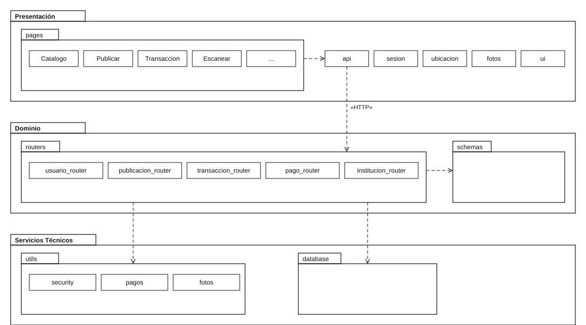
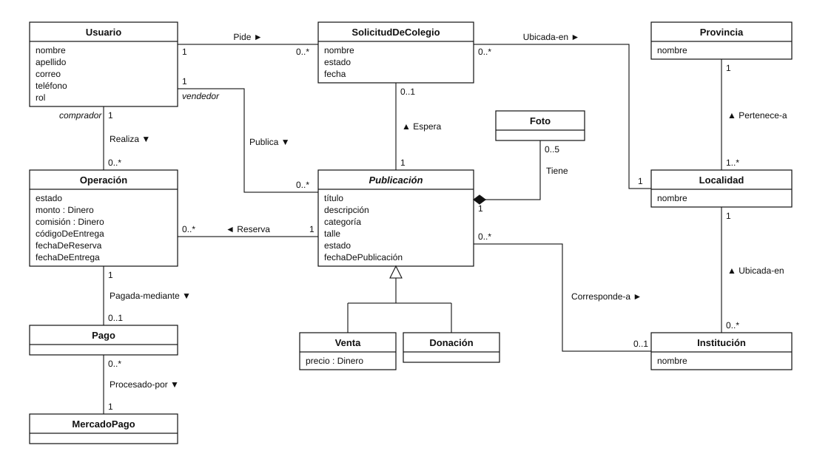
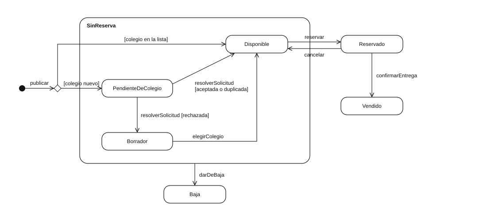

# 07 · Diseño del sistema

> Borrador. Reúne los diagramas UML que faltaban. El detalle del modelo relacional y de los estados está en el [capítulo 02](02-modelo-de-datos.md), y los diagramas de secuencia de pagar y cancelar en el [capítulo 03](03-arquitectura-y-pagos.md).

## Arquitectura

El sistema es cliente-servidor, con un frontend de una sola página y un backend monolítico que expone una API REST, como define el protocolo. El backend se organiza en capas dentro de un único despliegue. La única diferencia con el protocolo es que el backend corre en Vercel y no en Render ([decisión 003](../decisiones/003-backend-en-vercel.md)).

### Diagrama de despliegue y componentes

Sigue la notación de Larman (2003, cap. 38), que muestra en un solo diagrama los nodos y los componentes que se ejecutan en cada uno (fig. 38.5):
- Los **nodos**, dibujados como cubos, son unidades de proceso: el dispositivo del usuario y los tres servicios en la nube.
- Los **componentes**, con el ícono de dos pestañas, son las piezas que se despliegan o se reemplazan.
- Cada componente ofrece **interfaces**, los círculos, y los demás dependen de ellas con una línea punteada.

Nodos y componentes van subrayados porque son instancias concretas.

La estructura interna del backend (routers, schemas y servicios técnicos) no se repite acá: está en el diagrama de paquetes de la sección siguiente.

| Dependencia | Para qué |
|---|---|
| `:Frontend` → HTTPS de `:FrontendCompilado` | El navegador descarga la aplicación |
| `:Frontend` → API REST de `:Backend` | Todas las operaciones del usuario, con JWT |
| `:Frontend` → HTTPS de `:Storage` | Subir las fotos con una URL firmada |
| `:Frontend` → HTTPS de `:CheckoutPro` | El comprador paga en Mercado Pago |
| `:VercelCron` → API REST de `:Backend` | Vencer las operaciones una vez por día (`GET /vencer`) |
| `:Backend` → HTTPS de `:Storage` | Firmar las URL de subida de las fotos |
| `:Backend` → SQL de `:PostgreSQL` | Leer y escribir los datos |
| `:Backend` → API REST de `:APIDePagos` | Crear preferencias, consultar pagos y pedir devoluciones |
| `:APIDePagos` → webhook de `:Backend` | Avisar que se recibió un pago |

### Arquitectura lógica en capas

La arquitectura lógica sigue el patrón Capas (Larman, 2003, cap. 30) y se muestra con un diagrama de paquetes UML:
- Cada capa es un paquete.
- Las dependencias van en línea punteada, siempre hacia la capa de abajo o dentro de la misma capa.
- Como recomienda el libro, el diagrama muestra solo los elementos que ayudan a entender la estructura.

No hay una capa de Aplicación separada. Los routers cumplen a la vez el rol de controlador, porque reciben los pedidos de la presentación, y el de reglas del dominio. Es la misma decisión que toma Larman en su caso de estudio, donde el controlador vive en la capa del Dominio mientras el sistema es chico (2003, fig. 30.2). La presentación depende del dominio solo a través de `api`, que hace los pedidos HTTP a la API REST.

| Capa | Paquete | Responsabilidad |
|---|---|---|
| Presentación | `frontend/src/pages` | Una pantalla por ruta |
| Presentación | `frontend/src` (`api.ts`, `sesion.tsx`, `ubicacion.tsx`, `fotos.ts`, `ui.tsx`) | Cliente de la API, sesión, ubicación, tratamiento de fotos y componentes compartidos |
| Dominio | `backend/routers` | Un módulo por recurso. Reciben el pedido, aplican las reglas de negocio y ejecutan la transacción SQL |
| Dominio | `backend/schemas` | Modelos Pydantic que validan lo que entra y definen lo que sale |
| Servicios Técnicos | `backend/utils` | Seguridad (JWT, bcrypt, roles) e integraciones externas (Mercado Pago y Supabase Storage) |
| Servicios Técnicos | `backend/database` | Conexión, esquema SQL y migraciones |

`backend/main.py` crea la aplicación, configura CORS y registra los routers. No figura en el diagrama porque solo arma las piezas.

### Diagrama de clases de diseño

> **PROVISORIO: evaluar si se borra esta sección.** Se dejó para justificar la ausencia del diagrama, pero puede no hacer falta.

No se incluye un diagrama de clases de diseño (Larman, 2003, cap. 19). Ese diagrama muestra las clases del software con sus métodos, y en este sistema casi no las hay:
- El backend sigue el estilo de guion de transacción (*transaction script*): cada operación del sistema es una función de un router que valida, aplica las reglas de negocio y ejecuta su transacción SQL.
- El frontend está hecho con componentes funcionales de React.
- Las únicas clases propias son los schemas de Pydantic, que solo tienen campos con tipo y repiten lo que ya muestra el modelo de datos del capítulo 02.

Dibujar clases con métodos que no existen en el código haría que el diseño y la implementación no coincidieran. Por eso la estructura del software se muestra con el diagrama de paquetes de esta sección y su comportamiento con los diagramas de secuencia del capítulo 03.

## Modelo de dominio

El modelo del dominio muestra las clases conceptuales del problema: cosas del mundo real de las que hablan los usuarios, no clases del programa ni tablas de la base (Larman, 2003, cap. 10). Por eso no tiene operaciones ni claves ajenas. Las clases conceptuales se relacionan con asociaciones, no con atributos. Las reglas citadas están en el capítulo 01.

Las clases conceptuales salieron de los casos de uso del capítulo 06 y de la lista de categorías de Larman: lugares (Provincia, Localidad, Institución), transacciones (Operación, Pago), sistemas externos (MercadoPago) y registros (SolicitudDeColegio).

**Decisiones del modelo**

- **Publicación es una generalización de Venta y Donación.** Las dos subclases se tratan distinto: la venta tiene precio, comisión y pago, y vence a las 24 horas si no se paga; la donación no tiene precio y cada receptor puede tener 3 pendientes como máximo (RN-01, RN-12). Larman (2003, cap. 26) justifica una subclase cuando tiene atributos, asociaciones o reglas propias. Publicación figura en cursiva porque es abstracta: toda publicación es una venta o una donación. En la base, las dos se guardan en una sola tabla con un discriminador de tipo (capítulo 02). El modelo del dominio no es el modelo de datos.
- **Provincia y Localidad son clases conceptuales, no atributos de Institución.** Una ciudad es un lugar real, no un texto. Además, el catálogo se filtra por ellas (CU-03).
- **Foto es una clase conceptual aparte.** Una publicación tiene hasta 5 fotos, y un atributo con varios valores va en otra clase (Larman, 2003, cap. 27). La relación es una composición: las fotos no existen sin su publicación.
- **El pago es una clase conceptual.** Solo las ventas tienen pago (multiplicidad 0..1), y lo procesa Mercado Pago, que figura como sistema externo.
- **No hay asociación entre la operación y su vendedor.** El vendedor se obtiene a través de la publicación, y Larman recomienda no mostrar asociaciones derivadas.
- **Una publicación puede tener varias operaciones a lo largo del tiempo**, porque una operación cancelada la devuelve al catálogo, pero nunca más de una en curso (RN-03).
- **Una publicación puede no tener institución** mientras espera el alta de su colegio (multiplicidad 0..1, RN-15).

## Comportamiento

El diagrama de estados de la operación está en el capítulo 02, y los de secuencia de pagar y cancelar, en el capítulo 03. Este es el diagrama de estados de una publicación:

Sigue la misma notación que el de la operación: evento, `[condición de guarda]` y `/ acción`. Los estados llevan el nombre del valor de `estado` en la base.

- **Superestado `SinReserva`:** agrupa los tres estados en los que la publicación no tiene una operación en curso. Desde cualquiera de ellos el dueño puede darla de baja (RN-11). Larman (2003, fig. 29.5) usa estados anidados para esto: los subestados heredan la transición del superestado, y una sola flecha `darDeBaja` reemplaza a tres.
- **Rombo después de `publicar`:** es una bifurcación. La publicación empieza en `Disponible` o en `PendienteDeColegio`, según si el colegio estaba en la lista.
- **`cancelar`** cubre tanto la cancelación de una parte como el vencimiento de un plazo, igual que en el diagrama de la operación.

## Diseño de datos

El modelo físico, sus restricciones y la decisión de usar una sola entidad con discriminador de tipo están en el capítulo 02.

## Seguridad

| Amenaza | Medida | Requerimiento |
|---|---|---|
| Robo de contraseñas | Hash con bcrypt | RNF-01 |
| Uso de un token robado | JWT firmado con vencimiento de 2 horas | RNF-02 |
| Fuerza bruta en el ingreso | Bloqueo de 15 minutos tras 5 intentos | RNF-03 |
| Acceso a datos de otra persona | Verificación de pertenencia en cada operación | RNF-04 |
| Liberar los fondos sin encuentro | El QR es un UUID aleatorio que solo ve el comprador, y solo el vendedor puede escanearlo | RN-04, RN-05 |
| Simular un pago | Firma HMAC del aviso y consulta directa a Mercado Pago | RNF-07 |
| Doble reserva o carreras entre operaciones | Bloqueo de fila dentro de una transacción | RNF-06 |
| Acceso directo a la base por la API de Supabase | Row Level Security activo sin políticas | RNF-04 |
| Subir archivos ajenos o peligrosos | URL firmada, tipos permitidos y verificación del autor de cada foto | RN-14 |

## Integraciones

| Sistema | Para qué | Cómo se aísla |
|---|---|---|
| Mercado Pago | Crear preferencias, consultar pagos y devolverlos | `utils/pagos.py` |
| Supabase Storage | Subida directa de fotos desde el navegador | `utils/fotos.py` |
| Georef | Provincias y localidades oficiales | Dataset estático generado por `frontend/scripts/localidades.mjs` |

## Patrones utilizados

| Patrón | Dónde | Problema que resuelve |
|---|---|---|
| Cliente-servidor y API REST | Frontend y backend | Separa la interfaz de las reglas de negocio |
| Arquitectura en capas | `routers`, `schemas`, `utils`, `database` | Ordena las responsabilidades dentro del monolito |
| Inyección de dependencias | `Depends(get_usuario_actual)`, `requerir_admin`, `requerir_cron` | La autorización se declara en cada endpoint y no se repite adentro |
| Objeto de transferencia de datos | Modelos Pydantic en `schemas` | Lo que entra se valida y lo que sale está definido, por ejemplo sin exponer el hash de la contraseña |
| Gateway | `utils/pagos.py`, `utils/fotos.py` | Encapsula las API externas; los tests las reemplazan con dobles |
| Máquina de estados | `estado_pago` y `estado` de la publicación | Solo se permiten las transiciones válidas de una operación con dinero |
| Herencia en una sola tabla | `publicaciones.tipo` con la restricción `precio_segun_tipo` | Ventas y donaciones comparten todo salvo el precio |
| Bloqueo pesimista | `SELECT ... FOR UPDATE` en reservas, escaneos, cancelaciones y solicitudes | Evita carreras entre operaciones simultáneas |
| Receptor idempotente | Webhook de pagos y clave de idempotencia en las devoluciones | Mercado Pago reintenta los avisos y una devolución no puede duplicarse |
| Contexto de React | `sesion.tsx` | Comparte la sesión entre pantallas sin pasarla por cada componente |

## Referencias

Larman, C. (2003). *UML y patrones: Una introducción al análisis y diseño orientado a objetos y al proceso unificado* (2.ª ed.). Pearson Educación.
