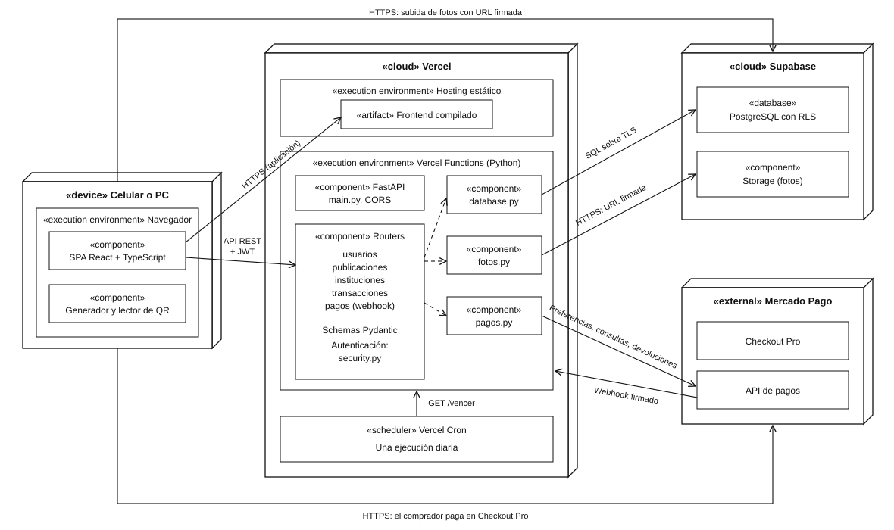
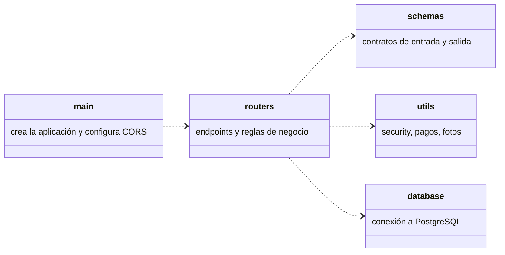
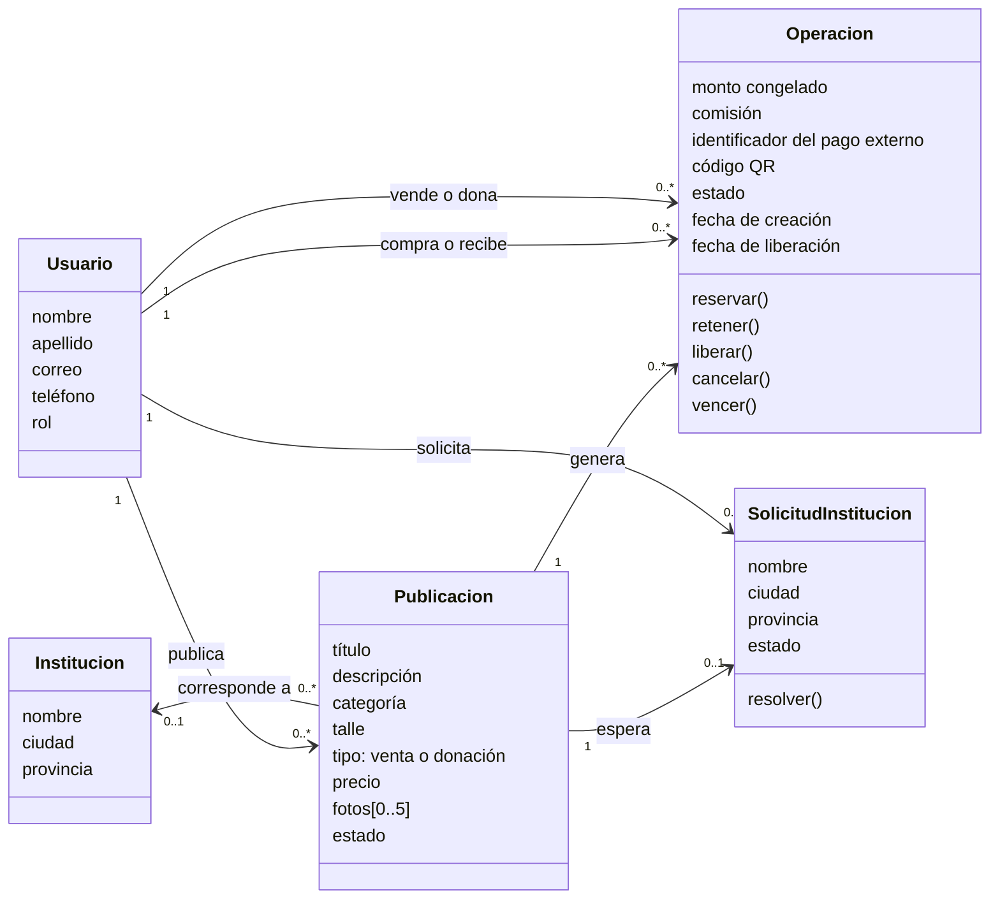
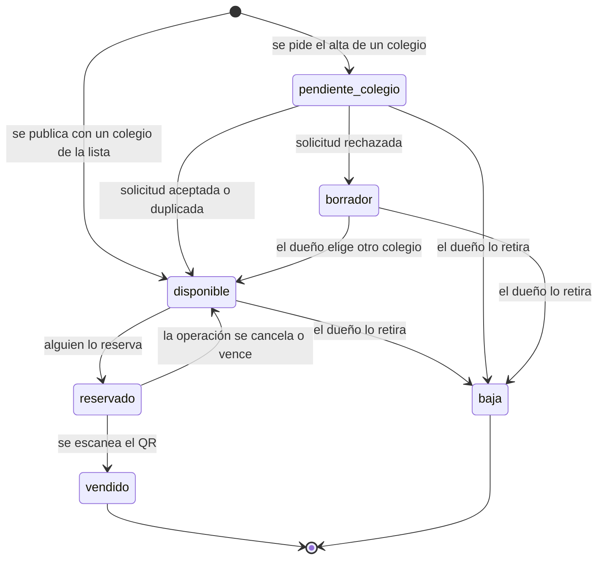

# 07 · Diseño del sistema

> Borrador. Reúne los diagramas UML que faltaban. El detalle del modelo relacional y de los estados está en el [capítulo 02](02-modelo-de-datos.md), y el flujo de pago con su diagrama de secuencia en el [capítulo 03](03-arquitectura-y-pagos.md).

## Arquitectura

El sistema es cliente-servidor, con un frontend de una sola página y un backend monolítico que expone una API REST, como define el protocolo. El backend se organiza en capas dentro de un único despliegue. La única diferencia con el protocolo es que el backend corre en Vercel y no en Render ([decisión 003](../decisiones/003-backend-en-vercel.md)).

### Diagrama de despliegue y componentes

### Paquetes

| Paquete | Responsabilidad |
|---|---|
| `backend/routers` | Un módulo por recurso. Reciben el pedido, aplican las reglas de negocio y ejecutan la transacción SQL |
| `backend/schemas` | Modelos Pydantic que validan lo que entra y definen lo que sale |
| `backend/utils` | Seguridad (JWT, bcrypt, roles) e integraciones externas (Mercado Pago y Supabase Storage) |
| `backend/database` | Conexión, esquema SQL y migraciones |
| `frontend/src/pages` | Una pantalla por ruta |
| `frontend/src` (`api.ts`, `sesion.tsx`, `ubicacion.tsx`, `fotos.ts`, `ui.tsx`) | Cliente de la API, sesión, ubicación, tratamiento de fotos y componentes compartidos |

## Modelo de dominio

Representa los conceptos del problema, sin detalles de la base de datos. Las reglas citadas están en el capítulo 01.

Una publicación puede tener varias operaciones a lo largo del tiempo, porque una operación cancelada la devuelve al catálogo, pero nunca más de una en curso (RN-03).

## Comportamiento

Los diagramas de estados de la operación y de secuencia de una venta están en los capítulos 02 y 03. Este es el diagrama de estados de una publicación:

## Diseño de datos

El modelo físico, sus restricciones y la decisión de usar una sola entidad con discriminador de tipo están en el capítulo 02.

## Seguridad

| Amenaza | Medida | Requerimiento |
|---|---|---|
| Robo de contraseñas | Hash con bcrypt | RNF-01 |
| Uso de un token robado | JWT firmado con vencimiento de 2 horas | RNF-02 |
| Fuerza bruta en el ingreso | Bloqueo de 15 minutos tras 5 intentos | RNF-03 |
| Acceso a datos de otra persona | Verificación de pertenencia en cada operación | RNF-04 |
| Liberar los fondos sin encuentro | El QR es un UUID aleatorio que solo ve el comprador, y solo el vendedor puede escanearlo | RN-04, RN-05 |
| Simular un pago | Firma HMAC del aviso y consulta directa a Mercado Pago | RNF-07 |
| Doble reserva o carreras entre operaciones | Bloqueo de fila dentro de una transacción | RNF-06 |
| Acceso directo a la base por la API de Supabase | Row Level Security activo sin políticas | RNF-04 |
| Subir archivos ajenos o peligrosos | URL firmada, tipos permitidos y verificación del autor de cada foto | RN-14 |

## Integraciones

| Sistema | Para qué | Cómo se aísla |
|---|---|---|
| Mercado Pago | Crear preferencias, consultar pagos y devolverlos | `utils/pagos.py` |
| Supabase Storage | Subida directa de fotos desde el navegador | `utils/fotos.py` |
| Georef | Provincias y localidades oficiales | Dataset estático generado por `frontend/scripts/localidades.mjs` |

## Patrones utilizados

| Patrón | Dónde | Problema que resuelve |
|---|---|---|
| Cliente-servidor y API REST | Frontend y backend | Separa la interfaz de las reglas de negocio |
| Arquitectura en capas | `routers`, `schemas`, `utils`, `database` | Ordena las responsabilidades dentro del monolito |
| Inyección de dependencias | `Depends(get_usuario_actual)`, `requerir_admin`, `requerir_cron` | La autorización se declara en cada endpoint y no se repite adentro |
| Objeto de transferencia de datos | Modelos Pydantic en `schemas` | Lo que entra se valida y lo que sale está definido, por ejemplo sin exponer el hash de la contraseña |
| Gateway | `utils/pagos.py`, `utils/fotos.py` | Encapsula las API externas; los tests las reemplazan con dobles |
| Máquina de estados | `estado_pago` y `estado` de la publicación | Solo se permiten las transiciones válidas de una operación con dinero |
| Herencia en una sola tabla | `publicaciones.tipo` con la restricción `precio_segun_tipo` | Ventas y donaciones comparten todo salvo el precio |
| Bloqueo pesimista | `SELECT ... FOR UPDATE` en reservas, escaneos, cancelaciones y solicitudes | Evita carreras entre operaciones simultáneas |
| Receptor idempotente | Webhook de pagos y clave de idempotencia en las devoluciones | Mercado Pago reintenta los avisos y una devolución no puede duplicarse |
| Contexto de React | `sesion.tsx` | Comparte la sesión entre pantallas sin pasarla por cada componente |
